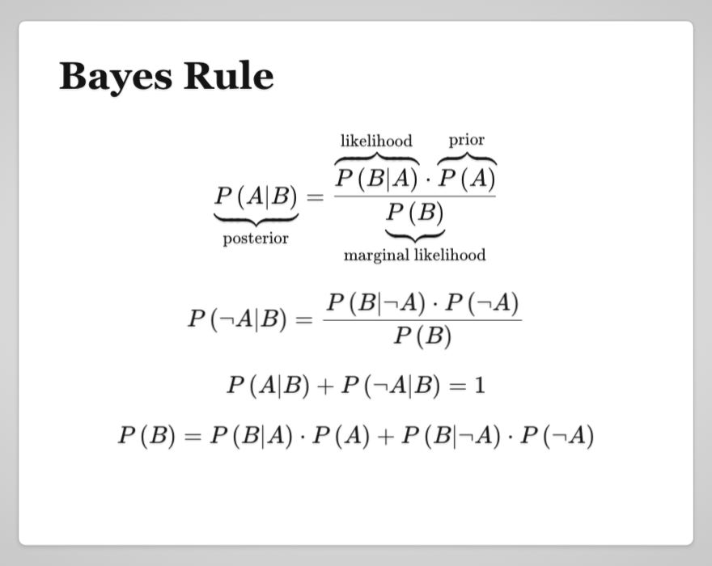

# Real life applications of mathematics

A talk with slides on how a little probability theory solves practical problems:
from Bayes' theorem to spam filtering, feature selection and spelling correction.

**▶ [Open the slides](https://dimchansky.github.io/real-life-applications-of-mathematics/)**

[](https://dimchansky.github.io/real-life-applications-of-mathematics/#/step-14)

## What's inside

1. **[An intuitive explanation of Bayes' theorem](https://dimchansky.github.io/real-life-applications-of-mathematics/#/intuitive-bayes)**:
   probabilities as areas, conditional probability, independence, Bayes rule,
   and worked examples (including the classic mammography problem).
2. **[Text classification using Naive Bayes](https://dimchansky.github.io/real-life-applications-of-mathematics/#/text-classification)**:
   MAP estimation, the conditional independence assumption, a toy spam/ham classifier,
   [Laplace smoothing](https://dimchansky.github.io/real-life-applications-of-mathematics/#/laplace-smoothing)
   and avoiding floating point underflow with logarithms.
3. **[Improving text classification using feature selection](https://dimchansky.github.io/real-life-applications-of-mathematics/#/improving-classification)**:
   confusion matrix, precision, recall, F-measure, entropy and mutual information
   between a term and a class.
4. **[Spelling correction using Bayes' theorem](https://dimchansky.github.io/real-life-applications-of-mathematics/#/spelling-correction)**:
   the model behind Peter Norvig's
   [How to Write a Spelling Corrector](https://norvig.com/spell-correct.html).

Navigate with the arrow keys or the space bar; on touch screens, tap the left or right side of the screen.

## Code

The [`code`](code) folder holds the C# examples used in the talk:

| Path | What it is |
|---|---|
| [`code/NaiveBayes`](code/NaiveBayes) | A small multinomial Naive Bayes library with Laplace smoothing; probabilities are exact fractions (`BigRational`). Visual Studio solution, .NET Framework 4.0. |
| [`code/text_classification.linq`](code/text_classification.linq) | A [LINQPad](https://www.linqpad.net/) script that reproduces the spam/ham example from the slides using the library above. |
| [`code/SpellingCorrection`](code/SpellingCorrection) | A C# port of Norvig's spelling corrector, with the `big.txt` training corpus and a prebuilt `pnsc.exe`. |

## How it's built

The site is a single static page, [`index.html`](index.html), with no build step:

- [impress.js](https://github.com/impress/impress.js) by Bartek Szopka for the presentation;
- [MathJax 2.7](https://www.mathjax.org/) from cdnjs for the LaTeX formulas; a small script in `index.html`
  shrinks formulas and slides that do not fit the frame.

GitHub Pages publishes the `master` branch as is, so a push to `master` updates the site within a minute or two.
To view it locally, serve the folder with any static server:

```bash
python3 -m http.server 8000
```

and open <http://localhost:8000/>.

## Credits

- The Bayes' theorem part and the mammography problem: Eliezer S. Yudkowsky,
  [An Intuitive Explanation of Bayes' Theorem](https://www.yudkowsky.net/rational/bayes).
- Feature selection figures: C. D. Manning, P. Raghavan, H. Schütze,
  [Introduction to Information Retrieval](https://nlp.stanford.edu/IR-book/), Cambridge University Press, 2008.
- Spelling corrector: Peter Norvig, [How to Write a Spelling Corrector](https://norvig.com/spell-correct.html).

Author: Dmitrij Koniajev ([@dimchansky](https://github.com/dimchansky)).
